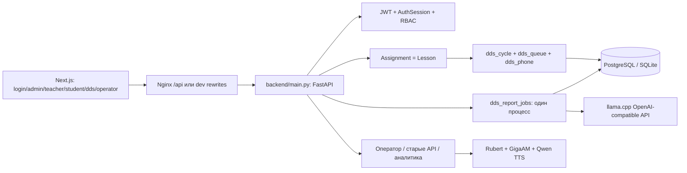

# Технический аудит 112 Simulator — 19 октября 2026

## Вывод

Проект содержит работающий учебный контур ДДС: подготовленный билет → урок/самотренировка → последовательная очередь карточек → телефонные доклады → протокол действий и критериев → история → фоновый нейроотчёт преподавателя. Это наиболее связная часть системы. Она подтверждена отдельными PostgreSQL-проверками, но обязательный gate сейчас красный.

Проект пока нельзя считать готовым к эксплуатации с недоверенными пользователями. Воспроизведены повышение роли через LDAP, вход без проверки первого фактора 2FA, захват административной учётной записи через состав учебной группы, операции с чужими данными и выдача эталонов курсанту. Старые подсистемы аналитики, телефонии и отчётов местами возвращают вымышленные результаты. Docker-инструкции расходятся с реальной поставкой моделей и сертификатов.

Рекомендуется сохранить основной DDS-контур и его визуальный контракт, закрыть границы доступа во всех поколениях API, явно обозначить неподдержанные интеграции и восстановить проверяемый процесс поставки. Оснований удалять операторский тренажёр, старые билеты или модели только по отсутствию статического импорта нет.

## Основание и методика

- Исходная ветка `feat/dds-phone-training`, HEAD `45da606`; рабочая копия существенно изменена. Аудит относится **к рабочей копии**, включая незакоммиченные DDS/phone/profile-изменения, а не только к HEAD. Полный список — [baseline-status.txt](evidence/baseline-status.txt).
- До запуска проверок сохранены diff, исходники и исходный `out` в `/tmp/112-audit-20261019/`. Перед исправлениями исходное состояние будет сохранено отдельным контрольным коммитом на новой ветке; отчёт реализации укажет его SHA.
- Перечислены все собственные исходники, конфигурация, скрипты, тесты, документы и исторические задания. Реестры: [inventory.json](evidence/inventory.json), [source-index.json](evidence/source-index.json), [documents-index.json](evidence/documents-index.json), [documents.md](documents.md). Инвентаризация включает некоторые бинарные/служебные файлы; число строк в JSON не следует трактовать как размер собственного кода.
- Выполнены разбор Python AST, compileall, адресный ручной разбор границ доступа/хранения/поставки, поиск динамических загрузок и импортов, анализ контрактов UI/API, тесты и аудит зависимостей. Статический охват файла не означает ручную проверку каждой его строки или доказательство отсутствия ошибок.
- Сторонние `node_modules`, сгенерированные Python bindings `backend/transcribe_cpp`, веса и бинарники не подвергались построчному аудиту. `models/classifier/inference.py` прочитан, поскольку это исполняемый Python, динамически импортируемый приложением. Генерируемый `out` проверен как результат сборки.
- Все проверки с данными использовали собственную временную SQLite либо новые PostgreSQL-контейнеры. Прикладная SQLite читалась только через `mode=ro&immutable=1` для схемы; расхождений столбцов с моделями в этом файле не найдено. Существующие сервисы и базы не изменялись.
- Ссылки `файл:строки` ниже относятся к **исходному снимку до исправлений**. Приоритет: P0 — непосредственный захват привилегий; P1 — нарушение доступа/достоверности/поставки; P2 — сопровождаемость и ограниченные риски.

## Фактическое устройство

| Область | Реальные точки входа и связи | Статус |
|---|---|---|
| Аутентификация | `router_auth.py`, `security.py`, `deps.py`, `auth_sessions.py`, `domain_01.py`; `/login`, `RequireAuth`, `api-fetch.ts` | Пароль, JWT, серверные сессии, logout/all, блокировка и TOTP реализованы; критические обходы F01–F04 |
| ADMIN | `/admin/{users,logs,system,security,profile}`, `router_admin/users/audit.py`, `integrity.py`, `scripts/backup_db.py` | Учётные записи, политики, журнал, ручной backup/download, целостность. ADMIN намеренно не преподаватель; отдельные DDS/report-допуски исторические |
| TEACHER | `/teacher/{groups,tickets,sessions,analytics,knowledge,profile}`, `router_groups/tickets/lessons/knowledge.py` | Группы, импорт, билеты, уроки, наблюдение, заметки, отчёты; часть старых аналитических функций недостоверна |
| CADET | `/student/profile`, `/student/lobby`, `components/student/profile-assignments.tsx`, `router_groups.py:469–834` | Свои занятия/история, самотренировка, вход в DDS. В БД допускается также `STUDENT`, но основные guards используют `CADET`; это совместимость данных, а не четвёртая полноценная роль |
| Диспетчер ДДС | `/dds`, `dds-assigned-console.tsx`, `lib/dds-cycle.ts`; `/api/dds/*`; `dds_cycle.py`, `dds_queue.py`, `dds_service_policy.py`, `dds_phone.py`, `dds_exercise.py` | Назначения, снимок билета, очередь, блокировки/idempotency, статусы и комментарии, телефонный справочник, принятые доклады, критерии, архив. Оценки намеренно nullable, отсутствие оценки не равно провалу |
| Самотренировка/демо | `/api/dds/training*`; `/api/v1/sessions/demo` и alias v2; отдельное локальное UI-демо | Сохраняемая тренировка использует подготовленные билеты, не должна фабриковать билет при пустом каталоге. Локальная демонстрация — отдельный путь; не удалять под видом дубля |
| Нейроотчёт DDS | `router_dds_reports.py`, `dds_report_data.py`, `dds_report_jobs.py`, `dds_report_llm.py`, `dds-lesson-report.tsx` | Авторизация преподавателя/ADMIN, сохранённый snapshot, атомарный claim, retry/recovery, санитизация ошибок, запрос к локальному runtime. Документированное ограничение: один процесс backend |
| Оператор 112 | `/operator`, `useTelephony.ts`, `useCallStore.ts`, `/api/v2/sessions/*`, `/api/v2/asr/*`, `runtime_router.py` | Карточка, текст/аудио, классификация, сдача/evaluate; включение новых уроков контролируется `ENABLE_OPERATOR_112_FOR_LESSONS`. Физический SIP неполон; F05/F06/F23 |
| Два диалоговых пути | `router_call.py → dialogue_router.py → tts_engine.py`; `router_sessions/asr.py → runtime_router.py → intent_classifier.py/tts_v2.py` | Оба подключены; первый использует первую matrix из БД и несуществующий audio URL. Это дефект/незавершённость, не доказательство ненужности всего движка |
| Билеты | `GeneratedTicket`, `ScenarioTicket`, `ScenarioTicketModel`; `router_tickets.py`, `router_scenarios.py`, `router_scenario.py`, `factoid_generator.py`, `factoids_llm.py` | Несколько форматов и генераторов с разными LLM: in-process GGUF, Ollama HTTP, подготовленный DDS. Совместимость нужна данным и тестам; автоматическое объединение без миграции опасно |
| Данные | `backend/database.py`; `domain_01…06`, `dds_report_job.py` | `User ↔ StudentGroup` хранится одновременно в M2M, `cadet_ids`, `group_ids`; `Assignment → ExamSession → IncidentCard/TicketResult/EvaluationResult`. JSON требует явного присваивания/flag_modified. `backend/db/database.py` — отдельный неиспользуемый engine |
| Эксплуатация | Compose dev/prod/LLM; `init.sh`, download/setup/seed, backup/pack/check/verify | Nginx статический export + API proxy; PostgreSQL 15; внешние модели. Backup PostgreSQL использует pg_dump 15. Модели не скачиваются init.sh, несмотря на документы |

## Реально выполненные проверки исходного состояния

| Команда | Результат и предел доказательства |
|---|---|
| `IMBA_VERIFY_REPORT_DIR=… bash scripts/verify_build.sh backend-core` | **383 passed, 13 failed**, exit 1. См. [backend-core.log](evidence/backend-core.log). Большинство расхождений — старые ожидания demo/finish/dispatch после принятия очереди; исправлять контракт теста на основании задания, не ослаблять сервер |
| `bash scripts/verify_build.sh backend-all` | Остановка сбора: `SileroTTSV2` отсутствует в текущем Qwen-модуле; [backend-all.log](evidence/backend-all.log) |
| `python -m pytest tests --continue-on-collection-errors -q --tb=short` | **565 passed, 55 failed, 1 collection error** за 89.12 с; [backend-diagnostic.log](evidence/backend-diagnostic.log). Есть старые запросы без auth, отключённые роли уроков, неактуальные ожидания TTS и реальные несовместимости |
| `npm test` | **396 passed, 23 failed**, 43 успешных и 10 падающих файлов, 419 тестов; [frontend-all.log](evidence/frontend-all.log) |
| `npm run typecheck`; `tsc --noEmit --incremental false -p frontend_react/tsconfig.json` | Оба exit 0; отдельно повторено после build, чтобы учесть generated routes |
| `DOCKER_BUILD=true NEXT_TELEMETRY_DISABLED=1 npm run build` | exit 0, 25 статических маршрутов; [frontend-build.log](evidence/frontend-build.log). Это не Docker build и не браузерная приёмка |
| `python -m pytest -c tools_tests/pytest.ini tools_tests -q` | **195 passed, 1 failed**, независимый gate выявляет падение поддержанного frontend-контракта; [independent.log](evidence/independent.log) |
| `python scripts/check_dds_queue_postgres.py` | **27 passed** на отдельном PostgreSQL 15, включая конкуренцию/retry; [postgres-queue.log](evidence/postgres-queue.log) |
| `python scripts/check_dds_phone_postgres.py` | **16 passed** на отдельном PostgreSQL 15; [postgres-phone.log](evidence/postgres-phone.log) |
| Дополнительные восемь probes | **8 passed**, то есть восемь опасных исходных поведений воспроизведены. [Код](evidence/audit_probes.py), [лог](evidence/proofs.log). Это доказательства дефектов, не успешная security-приёмка |
| `pip install --dry-run -r requirements.lock` в чистом Python 3.11 venv | Разрешение зависимостей проходит; **установка и импорт не подтверждены**. [resolve311.log](evidence/resolve311.log). Основные тесты запускались на установленном Python 3.14.3 с другими версиями библиотек |
| `pip-audit -r requirements.lock --no-deps --disable-pip` | 99 записей о CVE/advisories в 8 пакетах, **56 различных идентификаторов**; повторяющиеся записи присутствуют. Транзитивные пакеты этим режимом не проверены. [JSON](evidence/pip-audit.json) |
| `npm audit --json` | 25 затронутых пакетов: 24 high, 1 critical, включая транзитивные цепочки; [JSON](evidence/npm-audit.json). Достижимость каждого advisory оценена отдельно, не приравнивается к эксплуатации |
| `python -m pip check` | Установленное пользовательское окружение содержит конфликтующий `outetts`; он не заявлен в lock. Это характеристика окружения, не доказательство дефекта lock |
| Compose config | Оба основных Compose не проходят полный config без `.env`, даже с `--env-file .env.example`, потому что отдельный `env_file: .env` обязателен. Это ожидаемое требование файла, но документация должна его раскрывать; YAML прочитан отдельно |
| `bash scripts/test_pg_backup_restore.sh` | Доходит до отдельного PostgreSQL, затем падает: жёстко заданный backend image отсутствует. Backup/restore этим запуском **не подтверждён**; [лог](evidence/postgres-backup.log) |
| AST/compileall, `bash -n` | Синтаксис собственных Python и shell проходит. Ruff не нашёл F821/F823; предупреждения S311 подтверждены как проблема только для паролей, MD5 TTS — ключ кэша, а не криптографическая подпись |

## Подтверждённые находки и исправления

Каждая строка содержит доказательство, последствия, рекомендуемое изменение и проверку. Исполнение — в плане S1–S10 ниже. Полные исходные выводы сохранены в evidence.

| ID / приоритет | Доказательство в исходном снимке | Последствия | Исправление и проверка |
|---|---|---|---|
| F01 / **P0** LDAP выдаёт запрошенную роль и общий пароль | `router_auth.py:191–221`: `default_role = normalized_role`, hash литерала `ldap_provisioned_no_password`, затем local fallback. Probe `test_ldap_role_and_local_shared_password` получил ADMIN и повторный вход | Любой LDAP-пользователь может стать ADMIN; созданные LDAP-учётки имеют известный локальный пароль | JIT только CADET, локальный пароль случайный/непригодный, LDAP-роль не брать из тела. Проверить роль ADMIN, отключённую учётку, отказ LDAP и невозможность shared-password входа |
| F02 / **P0** второй фактор работает без первого | `router_auth.py:303–370`; принимает username/user_id + TOTP без challenge. Блокировка тоже не проверяется, ошибки TOTP не ограничены. `setup_2fa:419` заменяет уже активный secret | Уменьшение двухфакторного входа до одного фактора, обход lockout, случайная потеря TOTP | Короткий одноразовый серверный challenge после пароля, число попыток/срок/lockout; запрет переинициализации активного secret; не принимать challenge как access JWT. Проверить replay, expiry, неправильный account/code и рабочий login в UI |
| F03 / **P0** группа позволяет сбросить ADMIN | `router_groups.py:242–297,380–415,440–465`: добавляется любой существующий User, затем reset всех `group.students` без проверки роли. Probe добавил ADMIN в свою группу и получил новый пароль | Прямой захват административной учётной записи преподавателем | Разрешать привязку/импорт/массовый reset только курсантов; валидировать весь набор до изменений. Проверить ADMIN/TEACHER через single, CSV, обе формы membership |
| F04 / P1 преподаватель меняет чужого курсанта | `router_users.py:145–207,215–240,255–282`: проверяется роль цели, не принадлежность; probe reset чужого курсанта успешен. Создание/импорт используют фиксированный `cadet123`; reset_group — пятизначный `random.randint` | Захват чужих учебных учёток, предсказуемые пароли, обход политики длины | Общая проверка доступности курсанта; безопасное создание/привязка без лишения преподавателя управления новым пользователем; `secrets` и действующая политика длины. Проверить свои/чужие/новые учётки, блокировки и отзыв сессий |
| F05 / P1 старые session/DDS операции не проверяют владельца | `router_sessions.py:65–96,141–200,212–247,266–298,740–856`, `router_assignments.py:22–52`, `router_dds.py:151–208,260–318`, `router_call.py:55–135`. Чужая сдача подтверждена probe | Изменение/оценивание чужих сессий, подмена operator_id/assigned_by, доступ к чужим назначениям | Общие object-access helpers для владельца/учителя и явный автор из current_user; проверки до AI/телефонии/DB mutations. Проверить все aliases и отрицательные сценарии на двух преподавателях/курсантах |
| F06 / P1 ASR/телефония открыты, идентификатор становится путём | `router_asr.py:169–236`: нет auth, `session_id` из формы прямо в `data/records`; WS сразу accept. `router_telephony.py:354–416`: status/WS без auth, mutations без ownership. Frontend WS не отправляет credential | Чтение событий чужих звонков, расход ресурсов, запись за пределами records через form session_id; возможность управлять чужим каналом | Проверять серверную сессию и владельца до файлов/PBX/WS; безопасный handshake без токена в URL; нормализовать пути, привязать ticket к сессии. Проверить anonymous/foreign/expired/revoked, traversal и normal text/audio flow |
| F07 / P1 глобальные аналитика и отчёты | `router_analytics.py:116–1092` — запросы без owner; `router_reports.py:265–386` — запрос группы/сессий и TASKS по UUID без владельца | Преподаватель читает чужие результаты, генерирует и скачивает чужой отчёт | Сужать выборки до принадлежащих преподавателю групп/назначений, проверять record/session/group; хранить владельца задания. Проверить no-filter и explicit-filter, foreign task/status/download и orphan records |
| F08 / P1 эталоны выдаются курсанту | `router_tickets.py:43–49,420–570`: CADET получает ground_truth/factoids/etalon_services всего каталога и удалённый билет по ID. Probe подтвердил ответ | Подглядывание правильных ответов и будущих телефонных планов обесценивает учебную проверку | Отделить teacher ticket API от доступного курсанту server projection DDS; не выдавать решения из legacy endpoints; не ломать получение текущей карточки. Проверить все list/get/aliases и deleted tickets |
| F09 / P1 вымышленные результаты выглядят настоящими | `main.py:306–323`; `router_sessions.py:646–726`; `router_analytics.py:450–569,636–653,756–763`; `router_reports.py:185–202`; `ai_worker.py:52–160` | Несуществующие оценки/ответы/ИИ-выводы могут попасть в экран, экспорт и учебные решения; ungraded превращается в fail/50 | Удалить production fallback-данные, возвращать пустое/404/явную ошибку; не выводить числа без измерений. Локальное UI-демо сохранить явно. Проверить пустую БД, отсутствие LLM/оценок и сохранение реальных результатов |
| F10 / P1 конфигурация безопасности игнорируется | `security.py:19` известный default key; `main.py:177–184` wildcard credentials вместо `CORS_ORIGINS`; `router_auth.py:86–91` игнорирует ACCESS_TOKEN_EXPIRE_MINUTES без политики; `get_current_user` TESTING позволяет legacy JWT | Небезопасная установка по умолчанию, неожиданный доступ origin/срок токена, случайный TESTING в deployment ослабляет auth | Fail-fast на отсутствующем/примерном production secret, конечные origins, единый timeout, TESTING только в изолированных тестах. Проверить subprocess import/config и CORS preflight |
| F11 / P1 обновление схемы молча пропускает ошибки | `main.py:80–116`: набор ALTER с `except: pass`, Boolean DEFAULT 0 непереносим на PG, новые поля пользователей/очереди не покрыты; create_all не добавляет столбцы | Старый volume может стартовать с несовместимой схемой и падать на входе/уроке; причина скрыта | Проверяемые idempotent additive migrations для известных изменений, корректные dialect defaults, отказ с диагностикой на неизвестном drift; backup перед реальным обновлением. Проверить fresh/repeated/legacy SQLite и PostgreSQL, сохранность строк |
| F12 / P1 зависимости не обеспечивают безопасную воспроизводимость | `requirements.lock:5–52`, `requirements.txt`, `package.json:4,21,28,43–49`; direct-only pip audit и npm audit выше; passlib/psycopg2 не используются в собственном runtime, PDF engines/soundfile/llama_cpp не установлены lock, Torch не закреплён | Известные CVE, разные dev/CI/Docker, PDF не работает на чистом lock, неопределённый голосовой runtime | Обновить совместимый минимальный стек, прямой bcrypt, согласовать версии/Node, явно выделить необязательные ML/PDF зависимости; полный повторный audit и чистая установка/import/core/build. При advisories без fix не выдумывать исправление: описать достижимость и ограничение |
| F13 / P1 поставка моделей расходится с документацией | `init.sh:39–41` только печатает «built into image», Dockerfile исключает GGUF и не скачивает; `download_models.sh:47–50` пишет ASR в `/app/models` даже локально; `docker-compose.prod.yml:44` другой mount; `setup_env.py:15–18` абсолютные пути автора | Чистый deploy не получает ASR/TTS/LLM, молчаливый fallback; release не переносим | Единая схема read-only внешних моделей, явная проверка prerequisites/optional status, переносимый downloader с атомарным `.part`, без заведомо ложного автоскачивания. Проверить конфигурацию без моделей, с тестовыми путями и offline-mode |
| F14 / P1 опубликованный TLS-ключ и credentials | `certs/server.key` tracked, dev/prod Compose `admin:securepass`, `5432:5432`, backend `8000:8000`; `generate_certs.sh:11–14` скрывает ошибки openssl | Компрометация ключа, общедоступная БД с известным паролем, ложный TLS-успех | Убрать текущий ключ из tracking с сохранением локальной копии, генерировать локально с 0600 и fail-fast; обязательные переменные DB, loopback-only/отсутствующий DB port, публичный доступ через frontend. Требуется ротация ранее распространённых ключей/паролей владельцем среды; историю Git аудитор не переписывает |
| F15 / P1 release сообщает успех после ошибки | `pack_release.sh:1–33` нет `set -e`, нет cert script/models layout; `test_pg_backup_restore.sh:65–75` жёсткий отсутствующий image | Получается неполный offline release; restore не проверяется | Fail-fast, работа из корня, параметризованный image, включить инструкции/cert bootstrap/requirements, отдельная фактическая restore-проверка. Проверить неудачный docker build и успешный тест на отдельной БД |
| F16 / P1 нет границ для файлов/инференса/истории | `router_knowledge.py:99–115`, `router_tickets.py:703`, `router_groups.py:372`, `router_asr.py:62–68,183–233`, `tts_v2.py:144–164`; pool/requests без общего лимита | Исчерпание RAM/диска/CPU, зависший ffmpeg/TTS, сиротские uploads при DB error; Nginx limit обходится прямым backend | Прикладные bounded reads, ограничения очереди/текста, timeout subprocess, безопасные paths, компенсация upload при rollback; тест лимита до expensive operation и явной ошибки. Нагрузочные нормативы отдельно не подтверждены |
| F17 / P1 формулы в выгрузке | `reports_engine.py:194–207,337`: имя/строки пишутся как значения без нейтрализации `= + - @`; probe XLSX создал formula cell | Активные формулы при открытии преподавателем импортированных данных | Экранирование опасных строк CSV/XLSX, сохранение чисел числами; тесты реальных export bytes с openpyxl/CSV |
| F18 / P1 backend gate не соответствует текущему DDS | 13 падений и collection error выше; `test_dds_service_policy.py:78,134`, `test_dds_saved_tickets.py`, `test_student_dds_demo_flow.py`; принятые задания `DDS-LIVE-WORKFLOW-*`, `DDS-PHONE-TRAINING-20261019` | CI блокируется, старые тесты требуют запрещённого пропуска dispatch/генерации демо; реальный новый phone test не в core manifest | Актуализировать поддержанные сценарии по письменному контракту с обязательной передачей/complete; добавить phone/security tests в gate. Диагностические старые тесты сохранить с точными причинами, не менять manifests независимой приёмки |
| F19 / P1 frontend gate и mocks расходятся | 23 падения: отсутствует useRouter в mocks, не учтён include_history, уроки/аналитика ожидают старое default/demo, operator route test видит новый redirect. `dds-route.acceptance.test.tsx:33`, `incident-list.test.tsx:44` | Пропускаются рабочие проверки либо ошибочно обвиняется продукт; независимая приёмка красная | Исправить подтверждённые дефекты маршрутизации и обновить mocks/fixtures принятым контрактам; не добавлять runtime-ветки «для теста». Запустить все frontend тесты, typecheck и build |
| F20 / P1 CI не проверяет свежую интеграцию и не сохраняет диагностику | `.github/workflows/quality.yml:1–51`, manifests: phone/profile-home вне core, PG проверки только ручные; Node20 при новых Vite/Vitest, нет artifact upload | Merge может пропустить регрессию новых функций; диагноз падения теряется; локальное окружение не эквивалентно CI | Расширить gate, версии runtime согласовать с engines, сохранять отчёты always, добавить отдельный безопасный PG job. Проверить локальные команды CI; GitHub run/branch protection не заявлять без доступа |
| F21 / P2 документы смешивают требования и факт | README:58/DOCKER:46 обещают download; architecture/README:11,43 — Silero/Qwen0.8B; schema doc описывает несуществующий StorageManager; этапные briefs одновременно «не принято/исправлено» | Невозможно надёжно восстановить развёртывание и фактический статус | Новый единый docs index/карта/эксплуатация/реестр историй; пометить этапные задания архивом, сохранить исходные ссылки и доказательства; обновить root docs и quality claims. Проверить команды/ссылки, не трактовать ТЗ как реализацию |
| F22 / P2 альтернативный DB engine и глобальный monkeypatch | `backend/db/database.py:10–32` hardcoded app.db, импортов нет; `main.py:14–26` подменяет httpx во всём процессе только ради app= тестов | Случайный импорт создаёт другую БД; тестовая совместимость изменяет production HTTP client | Совместимый re-export canonical DB с deprecated путём либо безопасное удаление после проверки внешних скриптов; перенести httpx compatibility в тестовый слой. Проверить identity engine и независимую приёмку |
| F23 / P1 неподдержанные интеграции возвращают успех | `telephony_adapter.py:108,142,153`, `spo_gateway.py:54–57`, `router_tickets.py:1217–1231`, `router_scenarios.py:73`, `router_call.py:133` несуществующий audio route | Пользователь считает отправленным вызов/экспорт/AI-коррекцию, хотя внешнее действие не выполнено | Явный режим simulation/unavailable, honest status и 501/503 там, где реализации нет; не удалять интерфейс как ненужный. Реальный PBX/SOAP контракт и поставка остаются внешней интеграционной работой, не имитировать её успешную приёмку |
| F24 / P2 сгенерированный out хранится в Git и Docker context | 193 tracked файла out, уже грязный до аудита; `.dockerignore:43–45` оставляет output backend, `main.py:367–372` монтирует всю сборку под `/dds`, хотя assets абсолютные `/_next` | Огромные бессодержательные diff, stale UI в образе, неправильный standalone mount; build перезаписывает пользовательский output | Сохранить снимок, прекратить tracking output и исключить context; Nginx строит его заново. Backend-only UI явно не обещать. Удаление исходников компонентов/демо не требуется; проверить fresh build и Nginx маршруты |
| F25 / P2 профиль подставляет личность | `domain_01.py:87–89`, `router_users.py:49–55,137–138`: каждому курсанту Иванов/СМ1-12, GET изменяет объект | Неверные сведения в профиле/отчётах, чтение имеет побочный эффект ORM | Nullable реальное ФИО/номер, отображение username/«не указан»; не переписывать уже сохранённые имена автоматически. Проверить новый пустой профиль и имеющиеся данные |
| F26 / P2 не настроены эксплуатационные нормативы | `router_admin.py:78` только ручной backup; нет scheduled backup, политики retention/проверки restore, нагрузочных тестов 100 пользователей/20 сессий; DDS worker однопроцессный | Документальные требования О-15…О-25 не доказаны; риск роста диска/потери восстановления | Добавить переносимый режим периодического backup и документировать retention/restore/один процесс; нагрузочные/SIP/Windows испытания вынести в явно непроверенные внешние области. Не объявлять HA/100-user SLA реализованными |
| F27 / P2 аудит журналирует попытку как действие | `audit_middleware.py:28–59` пишет до call_next, доверяет role/sub JWT без текущей AuthSession, не сохраняет response status; `router_auth.py:53` доверяет X-Forwarded-For | Отозванный JWT создаёт ложные записи, нельзя отличить успех/отказ; spoofed IP | Разделить request-attempt и результат, записывать outcome после ответа и только проверенную identity, учитывать proxy trust. Проверить revoked/403/500/успех, explicit auth logs и отсутствие токенов/паролей в журнале |

F12: upstream подтверждает уязвимость Next 16.3.3 в Node `next/og ImageResponse` и fix 16.3.6: [официальный advisory](https://github.com/vercel/next.js/security/advisories/GHSA-vcvr-r3jv-pc5j). В этом проекте ImageResponse/OG routes не найдены, production — static Nginx, поэтому удалённая эксплуатация именно этого CVE не доказана. Другие advisories и dev server требуют отдельного обновления. Multipart DoS подтверждается [advisory Starlette](https://github.com/Kludex/starlette/security/advisories/GHSA-f96h-pmfr-66vw). Direct-only аудит lock не заменяет аудит установленного полного графа.

## Кандидаты на удаление/упрощение

| Кандидат | Уверенность и доказательство | Условия безопасного действия |
|---|---|---|
| `frontend_react/out/**` из Git | Высокая: build воспроизводит output, Docker frontend копирует builder output, содержимое уже многократно меняется | Сохранить текущий output вне Git, оставить локальные файлы, проверять rebuild; устранить обещание backend static hosting |
| `backend/db/database.py` как отдельный engine | Высокая: AST и rg не находят собственного consumer; canonical engine в `backend/database.py` | Предпочтителен re-export на переходный период: внешнее использование не доказано отсутствующим |
| `update_readme.py`, `update_docker_md.py`, `update_docker_compose.py`, `frontend_react/scale_ui.py`, `fix_db.py` | Высокая как одноразовые патчи: нет caller в build/runtime/CI/docs операций, повторное исполнение неидемпотентно и портит современный код/конфиг | Архивировать с предупреждением и исходным содержимым; не запускать. `fix_db` заменить настоящим schema tool |
| `check_db.py`, `check_schema.py` | Средняя: ad-hoc, выполняются при import, не применяют единый config | Заменить безопасной явно запускаемой диагностикой; внешние персональные команды могут существовать |
| `passlib`, `psycopg2-binary`, `sip.js`, `@ant-design/icons`, `antd`, `shadcn` как runtime-зависимости | Высокая для отсутствия production imports; passlib используется только транзитивно для bcrypt; SIP import только закомментирован; shadcn имеет CLI/provisioning назначение | bcrypt объявить прямо; shadcn перенести в dev либо описать npx; удалить лишь доказанно неисполняемые runtime зависимости после полного build/test, сохранить SIP функцию как незавершённую в карте |
| Два seeder, TTS/LLM/dialogue реализации | Низкая для удаления: различное назначение, legacy endpoints подключены, есть прямые тесты/эксплуатационные CLI | Сохранить, обозначить режим/владельца/конфиг; сначала миграция данных и потребителей, затем deprecation |
| `incident-classifier.tsx` vs `IncidentClassifier.tsx` | **Не кандидат**: первый — case-compatible re-export, второй реализация | Сохранять до миграции всех импортов, учитывая Linux case sensitivity |
| `prompts/`, `docs/project-context/tasks`, старые обзоры, DOCX | Архивная роль подтверждена содержимым; не «мусор» | Сохранить пути и первоисточники, индексировать как историю. Не удалять `dds_sla.md` по одному отсутствию UI-импорта |
| `models`, native binaries, preseeded cache, reference voices | **Не объявлены лишними**: dynamic sys.path/ctypes/subprocess, runtime cache fallback | Не удалять без проверки полного offline speech сценария и процедуры восстановления; бинарную provenance/лицензии проверить отдельно |
| Два одинаково названных PDF в `data/uploads` | Низкая: совпадение названия не доказывает совпадение содержимого и отсутствие DB ссылки | Нужны hash + ссылки всех действующих БД и политика учебных материалов; аудитор их не удаляет |

## План исполнения в отдельной ветке

План включает исправления, которые можно проверить на собственных временных ресурсах. Продуктовые функции не удаляются на основании предположения. Для неподготовленных внешних интеграций исправляется ложное подтверждение успеха; реализация реального операционного PBX/SOAP не заявляется.

1. **S1 — сохранить baseline и закрыть вход:** контрольный коммит, отдельная ветка `codex/technical-audit-remediation`; F01/F02/F10 и безопасные схемы/политики входа. Регрессии LDAP/challenge/lockout/replay/config.
2. **S2 — единые границы объектов:** F03–F08, F04 пароли/новые учётки. Auth + ownership для REST/WS, всех aliases, групп, аналитики, exports и teacher tickets. Проверки доступа до expensive/external side effects; регрессии на разных ролях/владельцах.
3. **S3 — достоверность:** F09/F23/F25/F27; убрать фиктивные production результаты и подтверждения интеграций, сохранить явное демо, nullable оценки и фактические данные, уточнить аудит запросов.
4. **S4 — схема и ресурсы:** F11/F16/F17, безопасные additive migrations/diagnostics, bounded input/paths/timeouts, literal spreadsheet exports. Проверить legacy/fresh SQLite/PG и ограничения без ML.
5. **S5 — зависимости:** F12/F22. Согласовать manifests/lock/CI/Docker/runtime, применить доступные исправления advisories, убрать доказанные лишние runtime зависимости, вынести optional integrations; чистое окружение Python 3.11 и Node, повторный аудит полного графа с описанием остатка.
6. **S6 — поставка и эксплуатация:** F13–F15/F24/F26. Безопасные env/сертификаты/models layout, fail-fast release, image-param restore, периодический backup и честное описание ограничений; generated output сохранить локально и убрать из tracking.
7. **S7 — восстановить актуальные тестовые контракты:** F18/F19. Подтверждённые продуктовые ошибки исправить; устаревшие fixtures/ожидания текущих тестов обновить по принятым заданиям, сохранив обязательные проверки и независимые acceptance manifests. Для старых неподдержанных тестов — поимённый диагностический реестр, без скрытых skips/ослабления gate.
8. **S8 — CI:** F20; новый security/phone/profile охват, PostgreSQL приёмка, закреплённые runtime и сохраняемые логи; локальное исполнение эквивалентных команд.
9. **S9 — документация и архив:** F21/кандидаты; новая актуальная карта, запуск/модели/backup/security/testing, статусы всех документов; одноразовые патчи в архив, исходные исторические пути требований сохраняются.
10. **S10 — итоговая проверка и отчёт:** весь обязательный gate, полная диагностика, typecheck до/после export, независимые tools_tests, PG queue/phone/restore, Docker/конфиг там, где доступно. Сохранить отдельный `IMPLEMENTATION.md`: SHA baseline/ветка, фактические изменения и результаты, каждое невыполненное испытание/остаточный риск. Не выдавать локальные проверки за опубликованный GitHub CI или live deployment.

## Предположения и непроверенные области

- Полный offline GPU/ASR/TTS голосовой сценарий: ASR GGUF в стандартном пути отсутствует; реальные внешние TTS веса и `llama_cpp` не являются гарантированной зависимостью lock. Качество классификации, кириллицы в PDF и живого голоса нельзя доказать mock-тестами.
- PBX/SIP/физические телефоны, SOAP WSDL и реальный SPO112 endpoint не предоставлены как тестовый стенд. Их отсутствие — ограничение интеграционной приёмки, а не основание считать функцию ненужной.
- Реальная загрузка локальной Qwen на GPU не выполнялась; DDS protocol проверялся с управляемыми ответами/недоступностью сервиса. Пользовательские prompts и ответы LLM остаются недоверенными данными, даже при fenced JSON.
- 100 пользователей, 20 одновременных вызовов, 150 мс latency, HA, несколько worker/process, Windows и мобильные браузеры не испытывались. Архитектура отчётов явно однопроцессная; горизонтальный запуск без отдельного worker/coordination не доказан.
- Наличие filesystem permissions, host encryption, доверенного TLS, настроенной ежедневной эксплуатации, 6-месячного хранения логов, лицензий/происхождения GGUF/native binaries, SBOM/container OS CVE и формального соответствия нормативным требованиям не установлено. Текст документа не доказывает соответствие.
- GitHub Actions и branch protection: локальные команды и workflow проверены; удалённые runs/settings не читались, PR не создавался, merge/deploy не выполнялся.
- Неизвестное внешнее использование CLI/aliases/материалов нельзя исключить одним rg. Поэтому сомнительные удаления не входят в безусловный план; выбран архив/совместимость.
- Успешные тесты не доказывают отсутствие ошибок; часть coverage основана на mock-контрактах, lifespan в ASGITransport автоматически не вызывается. Schema/startup/restore требуют отдельных интеграционных запусков.
- Незакоммиченные исходные изменения принадлежат пользователю. Они сохраняются отдельным baseline; аудит не утверждает, что найденные проблемы внесены последним автором или последней веткой.
