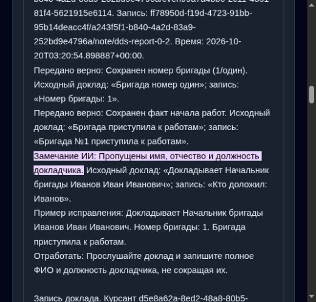
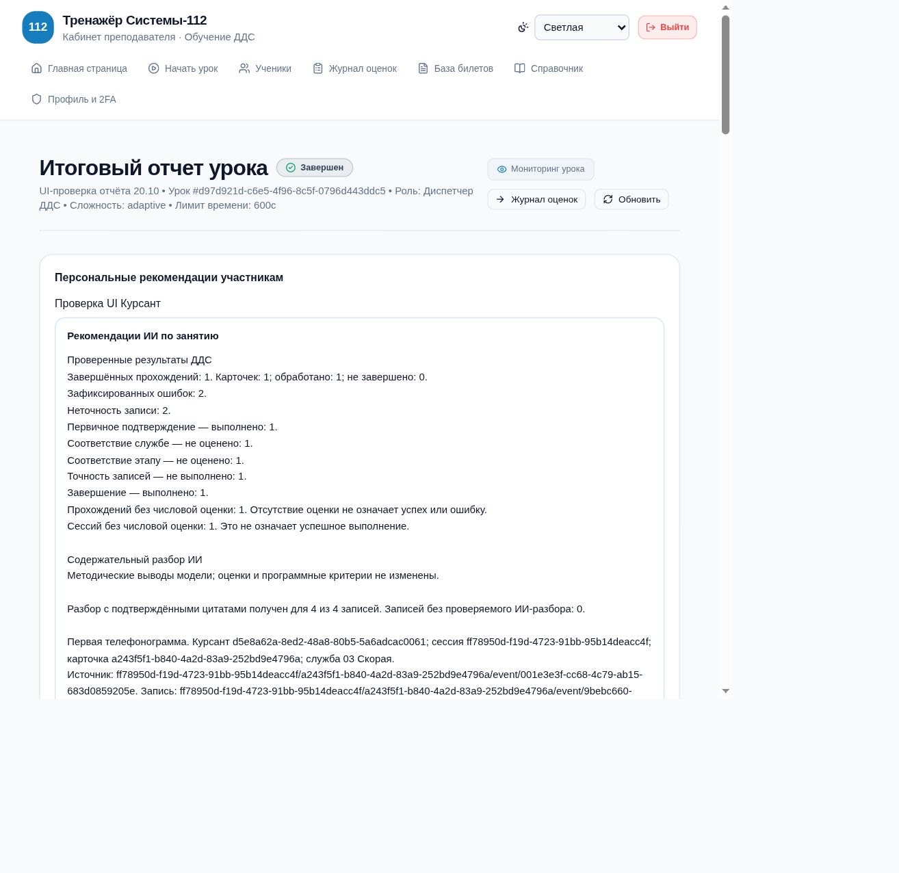

# Проверка нейроотчётов через браузер, 20.10.2026

Поручение: пройти интерфейс курсанта и преподавателя, сопоставить собственные ответы с реальным отчётом Qwen3.5-4B на CPU, записать и исправить найденные ошибки. Проверка проводится после пересборки и пересоздания пяти контейнеров проекта с сохранением томов.

## Контрольное занятие

Отдельные учётные записи `ui_teacher_1020` и `ui_cadet_1020` созданы через администраторскую форму. Пароли в отчёт не включены. Преподаватель через UI создал группу «UI-проверка отчёта 20.10», добавил только тестового курсанта, выбрал существующий билет ОМ_Р_4 и запустил симуляцию.

- Занятие: `ab200d7c-1701-42b0-8a24-cdd546e23444`.
- Сессия курсанта: `5e84d4e2-f4dc-4041-982d-83303729af8b`.
- Карточка: `2aae32fb-2615-4ca5-9c49-9c932f284564`.
- Эталонные телефонные сообщения просмотрены в UI преподавателя, исходный билет не редактировался.
- Курсант через учебный телефон набрал 7000, сохранил исходящий и три входящих доклада, отметил все четыре этапа и отправил карточку кнопкой «Отработана».
- Фабула: человек упал, тяжело дышит и не реагирует. Категория билета «Роды» не согласуется с фабулой; это замечание к подготовке существующих данных, не ошибка ответа курсанта. Билет не исправлялся задним числом.
- В рабочей карточке также были ГКУ НТУ и Департамент культуры; по обеим службам сохранены мотивированные отказы. Проверка общего SLA поэтому ожидаемо отмечает поздние решения по этим службам; это не ИИ-оценка содержания телефонных записей.

| Запись | Введено через UI | Что должно быть в содержательном разборе |
|---|---|---|
| Выезд | Кто: «Начальник бригады Иванов Иван Иванович»; номер: `2`; содержание: «Бригада №2 выехала к месту происшествия.» | Номер ошибочен: в докладе бригада №1. ФИО, должность и факт выезда сохранены. Нельзя утверждать, что пропущены сведения в устной передаче исходного задания: записи речи курсанта нет. |
| Прибытие | Те же полные ФИО и должность; номер `1`; «Первая бригада уже на месте происшествия, прибытие подтверждено.» | Корректная перефразировка; «первая» и «1» соответствуют «номер один». |
| Проведение работ | Кто: «Иванов»; номер `1`; «Бригада №1 приступила к работам.» | Фамилия и действие сохранены, имя, отчество и должность пропущены. Не следует объявлять пропущенным этап работ. |
| Завершение | Полные ФИО и должность; номер `1`; «Работы завершены.»; комментарий статуса тот же | Сопоставить с эталоном «Работы завершены. Задача выполнена.». Отметить отсутствие результата только в пределах этого общего эталона; не придумывать госпитализацию или иные медицинские действия. |

## Воспроизведённые проблемы и исправления

1. При входе во время перезапуска backend nginx вернул HTML, интерфейс показал `Unexpected token '<' ... is not valid JSON`. Добавлена понятная ошибка временной недоступности, сохранена обработка обычных JSON-ошибок и 2FA.
2. Страница входа показывала пароли несуществующих демонстрационных аккаунтов. В базе были только admin, popov1, ivanov1. Подсказка заменена указанием использовать выданную администратором учётную запись; демонстрационный блок не отражал отдельный режим авторизации.
3. При нажатии «Завершить урок» (обработчик использовал `window.confirm`) исходная вкладка встроенного браузера перестала отвечать, после чего нажатия и прокрутка в новых вкладках не давали эффекта. Предполагаемая причина — системное подтверждение; API getJsDialog не обнаружил доступного диалога, поэтому причина не считается доказанной. Чтение DOM и навигация продолжили работать. Заменено встроенным двухэтапным подтверждением с отменой. Компонентная проверка подтверждает отсутствие POST до подтверждения, отмену и ровно один запрос завершения. Старую заблокированную вкладку средство управления закрыть не смогло; пользователь уведомлён. Завершение контрольного урока через API, если потребуется, отмечается отдельно ниже и не выдаётся за успешное нажатие в UI.
4. Автоматическая проверка правил ошибочно объявляла пропущенным этап в записях «Бригада №2 выехала...» и «Бригада №1 приступила к работам.», поскольку требовала буквальное название статуса. Добавлен закрытый словарь формулировок этапов с проверкой границ слов и отрицаний. Ошибки номера, ФИО и должности продолжают проверяться отдельно. Уже сохранённая история контрольного занятия не переписывается.

## Проверки

- Телефонный цикл и регрессии формулировок: 48 backend-тестов на изолированной SQLite прошли.
- Вход и отображение отчётов/подтверждение завершения: 50 frontend-тестов прошли.
- Итоговое содержательное сравнение выполнено на страницах обеих ролей; ограничение повторной кликовой проверки завершения описано ниже.

Дополнительно воспроизведено в UI ученика: после остановки урока преподавателем осталась надпись «общее занятие ещё идёт», а временный 502 во время перезапуска прекратил опрос рекомендаций. Разбор теперь обновляет состояние активного занятия до его завершения; GET рекомендаций автоматически повторяется после сетевых/5xx ошибок. Ошибки авторизации и некорректные успешные ответы автоматически не повторяются, POST генерации при восстановлении соединения не выполняется.

Контрольное занятие завершено через штатный API от имени тестового преподавателя после блокировки системного браузерного подтверждения. Статус COMPLETED подтверждён на странице преподавателя; общий и персональный блоки сами показали процесс реального анализа.

## Первый результат настоящей модели

Оба отчёта автоматически появились в браузере, каждый с четырьмя проверяемыми парами цитат. В обоих ИИ верно указал номер 2 вместо 1 и не выдал ошибку на перефразировку прибытия, но пропустил отсутствие имени, отчества и должности в записи «Иванов». Это содержательный дефект модели, а не повод считать отчёт полностью прошедшим приёмку по надписи «4 из 4». Системный промпт дополнен проверкой полноты реквизитов и примером на другой фамилии; в CPU-приёмку добавлен отдельный контроль `held_out_identity` на фактически введённой записи.

Отсутствие фразы «Задача выполнена» не доказывает потерю конкретного результата: исходный доклад сам не содержит конкретных действий. Вывод о таком пропуске из первоначального плана проверки снят как необоснованный; ожидается отсутствие выдуманных требований о госпитализации/медицинской помощи. В промпте уточнено различие общего итога и конкретного результата; прежний независимый контроль потери «водитель деблокирован и передан медикам» сохранён.

После исправления эквивалентности общего итога повторно прошли 48 тестов телефонного цикла и 25 тестов семантических отчётов/восстановления. Независимый scope guard прошёл 4 проверки. Настоящая Qwen3.5-4B: корректная перефразировка без замечаний (79,74 с, включая первичное заполнение нового кэша), потеря конкретного результата найдена (64,21 с), пропуск ФИО/должности найден (57,70 с). Во всех трёх ответах 1450 токенов системного префикса использованы из кэша. Формулировка модели сначала путала реквизиты докладчика с реквизитами курсанта; системный промпт уточнён, контроль усилен запретом этой подмены.

Для итогового сравнения после исправлений повторяются те же записи в новой попытке только тестового курсанта. Повтор выполняется через публичный API из-за оставшегося блокировки управления старой браузерной вкладкой; это не выдаётся за второй полностью кликовый прогон. Старые готовые отчёты и исходные ответы сохраняются.

Повторная попытка: занятие `07303a32-93b8-49eb-9823-fd84d1ad6dab`, сессия `6c6dd22a-92d4-4234-9233-cff623fa285f`, карточка `9f7c57ed-2491-487f-beb8-9ee706e8477a`. В UI подтверждено: остались два события неточности (номер и неполные ФИО/должность), ложные претензии к выезду/началу работ/общему завершению исчезли. Решения по дополнительным службам в повторе приняты сразу, поэтому первичное подтверждение прошло; это отличие времени выполнения, а не изменение правила SLA. Подпись записи изменена с «Передача задания» на «Телефонограмма», чтобы не выдавать сохранённый ответ службы за запись устной команды курсанта.

Окончательная проверка реквизитов докладчика настоящей CPU-моделью: 113,89 с с первичным прогревом изменённого системного префикса, затем использованы 1487 кэшированных токенов; вывод: «Пропущены имя, отчество и должность докладчика». Отдельная новая вкладка входа показывает актуальную инструкцию без несуществующих демо-логинов.

## Выявленная неустойчивость ролевых промптов

Повторные отчёты просмотрены в обоих кабинетах. Персональный разбор нашёл обе реальные ошибки и не потребовал повторения общего итога. Отдельно сгенерированный преподавательский разбор нашёл неполные ФИО, но пропустил подмену номера и ошибочно потребовал дословное «Задача выполнена». Следовательно, одна лишь доработка промпта не дала согласованного результата между ролями.

Исправление: факты одной замороженной записи теперь анализируются единым промптом независимо от аудитории. Первая телефонограмма и последующие доклады сохраняют разные задачи и кэшируемые системные префиксы. Два отчёта переиспользуют один проверенный результат сравнения; ID, модель, endpoint, все исходные данные и версия промпта входят в ключ. Успешные результаты хранятся только в ограниченном RAM-кэше на 512 пар, ошибки не кэшируются; исходная история готовых отчётов не переписывается. Компонентная роль и права доступа остаются раздельными. Новая попытка после этого изменения проверяется отдельно.

Проверки общего результата: 34 теста семантического отчёта, восстановления и преподавательского разбора прошли. Проверены одновременные отчёты двух ролей (один запрос), изменение текста, модели, курсанта и промпта (новый запрос), повтор после невалидного ответа (ошибка не закэширована), а также сетевой обрыв на следующей ещё не проверенной записи. Последний сетевой тест получил две действительно разные записи вместо дублированного одного объекта: требование не скрывать сетевой отказ сохранено, повторный вызов на тождественных данных теперь закономерно устраняется кэшем.

## Итог последнего прогона

- Занятие: `d97d921d-c6e5-4f96-8c5f-0796d443ddc5`.
- Сессия: `ff78950d-f19d-4723-91bb-95b14deacc4f`; карточка: `a243f5f1-b840-4a2d-83a9-252bd9e4796a`.
- Оба сохранённых отчёта completed, 4 из 4 записей с проверенными цитатами, непроверяемых записей 0.
- Семантические части текстов, прочитанных из DOM ученика и преподавателя, буквально совпадают.
- В обоих отмечены ровно две реальные неточности: номер 2 вместо 1 и отсутствие имени, отчества и должности докладчика. Для каждой приведены цитаты исходного доклада/собственной записи, исправление и упражнение.
- Верная перефразировка прибытия и общий итог завершения не объявлены ошибками. Сохранены ограничения: речь курсанта не записана, содержательный эталон карточки отсутствует; произвольные медицинские действия не приписаны заданию.
- По журналу настоящего llama.cpp выполнены ровно 4 генерации вместо 8; оба отчёта завершены за 211 секунд (3 мин 31 с). GPU не используется.
- Последние проверки: 48 тестов телефонного цикла, 34 теста семантических отчётов/восстановления/преподавательского разбора, 50 frontend-тестов и 4 проверки независимого scope guard прошли; production-сборка frontend и запуск обновлённого backend прошли.

[Текст из UI курсанта](browser-student-report.txt) · [Текст из UI преподавателя](browser-teacher-report.txt).

Полный повтор исключительно кликами не завершён: после сбоя исходной вкладки управление нажатиями/прокруткой не восстановилось; окончание первого урока и новые попытки выполнены через API. Исходные ответы первого прогона были введены через формы, последующие результаты прочитаны и сопоставлены в UI. Новое встроенное подтверждение завершения проверено тестом, повторное ручное нажатие остаётся в backlog UI-REPORT-01. Противоречивый билет «Роды» отмечен в DATA-02, без произвольного переписывания подготовленного задания.
